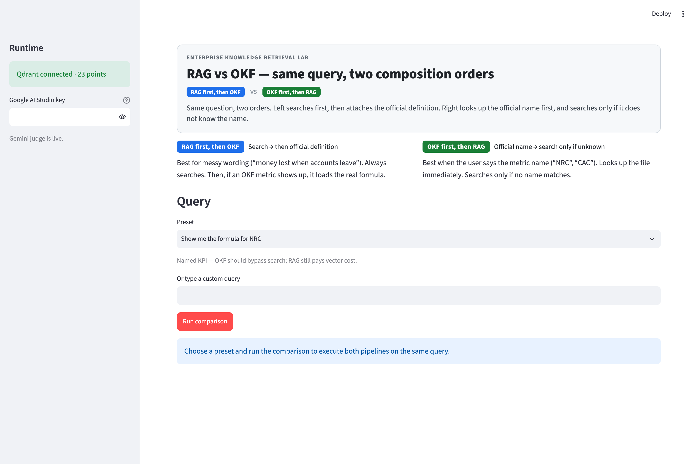
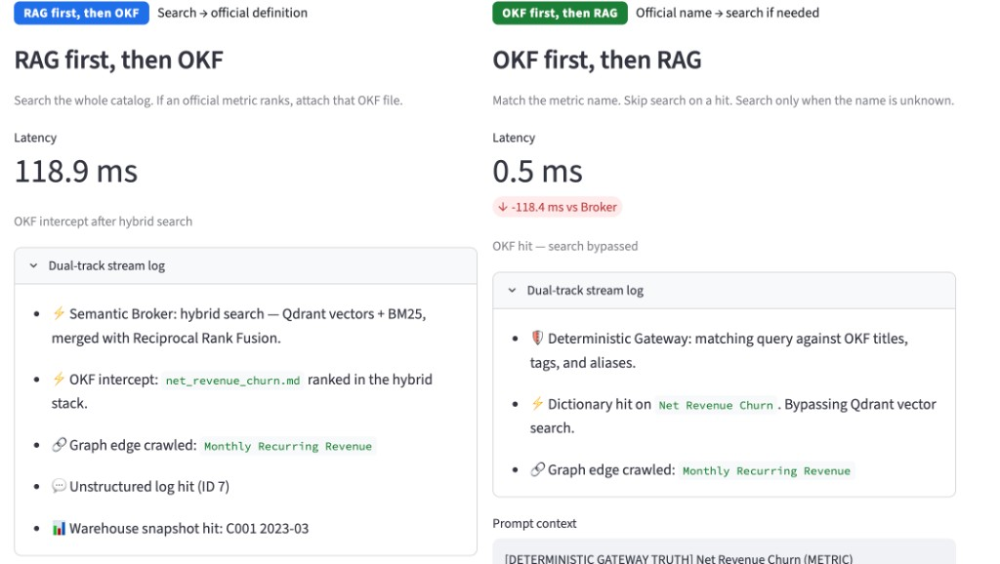
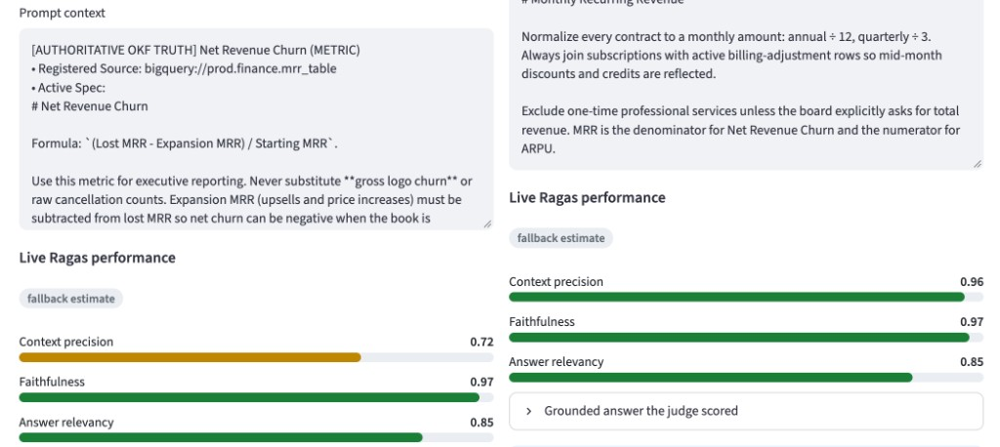
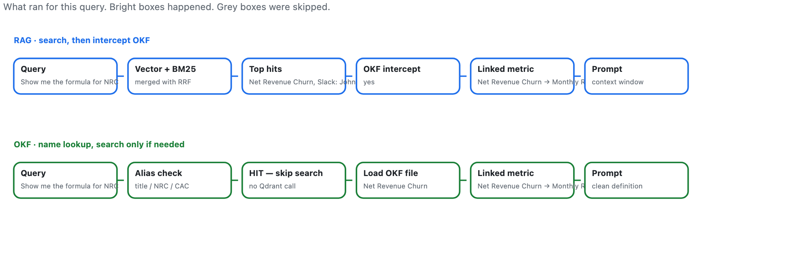
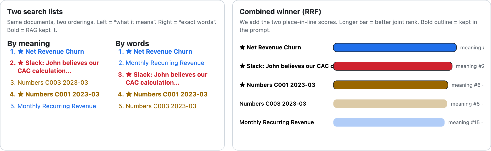

# RAGonOKF

**RAG running on top of an OKF knowledge layer** — a production-style lab that shows how Google’s [Open Knowledge Format (OKF)](https://github.com/google/open-knowledge-format) **complements** Retrieval-Augmented Generation (RAG), not replaces it.

Repository: [github.com/shunvel/rag-on-okf](https://github.com/shunvel/rag-on-okf)

License: [MIT](LICENSE)

---

## Table of contents

- [What this is](#what-this-is)
- [Screenshots](#screenshots)
- [Two pipelines on one query](#two-pipelines-on-one-query)
- [Why it exists](#why-it-exists)
- [Architecture](#architecture)
- [Ragas evaluation (Gemini judge)](#ragas-evaluation-gemini-judge)
- [Trade-off: Semantic Broker vs Deterministic Gateway](#trade-off-semantic-broker-vs-deterministic-gateway)
- [Demo queries](#demo-queries)
- [Tech stack](#tech-stack)
- [Project layout](#project-layout)
- [Prerequisites](#prerequisites)
- [Run locally](#run-locally)
- [Configuration](#configuration)
- [Secrets and API keys](#secrets-and-api-keys)
- [Regenerating README screenshots](#regenerating-readme-screenshots)
- [Design notes](#design-notes)

---

## What this is

**RAGonOKF** is an **Enterprise Knowledge Retrieval Lab**: a Streamlit dashboard that runs the **same analyst question** through two composition orders side by side:

| UI label | Pattern | Order |
| --- | --- | --- |
| **RAG first, then OKF** | Semantic Broker | Hybrid search → OKF intercept |
| **OKF first, then RAG** | Deterministic Gateway | Alias / tag route → hybrid search only on miss |

Each path builds a **prompt context window**. **[Ragas](https://github.com/explodinggradients/ragas)** scores both windows with **context precision (without reference)**, **faithfulness**, and **answer relevancy**, using **Gemini 3.8 Flash** (`gemini-3.8-flash`) as the judge LLM via Google’s **OpenAI-compatible API**. **Docker Qdrant** stores the catalog; **dense vectors + BM25** are fused with **Reciprocal Rank Fusion (RRF)**.

The catalog is a small **SaaS finance** knowledge base: canonical OKF metric nodes (NRC, MRR, CAC, ARPU) next to Slack threads, tickets, and warehouse snapshots that **contradict** official formulas. That tension is what the demo is designed to surface.

---

## Screenshots

**The lab** — preset or custom query, both pipelines on every run.



**Side-by-side result** — query *“Show me the formula for NRC”*: Gateway resolves the alias in **~0.5 ms** (search bypassed); Broker pays **~100 ms** for hybrid search before intercepting the same OKF node. **Dual-track stream logs** (expandable) show Qdrant hybrid search vs dictionary hit; the Gateway column shows the latency delta (e.g. **-118 ms vs Broker**).



**Live Ragas performance** — color-coded bars for context precision, faithfulness, and answer relevancy; engine badge shows **Ragas · gemini-3.8-flash** when the judge runs live (or **fallback estimate** when offline / no key).



**Pipeline flow** — bright boxes ran; grey boxes were skipped (Gateway skips Qdrant on a name hit).



**Hybrid retrieval** — semantic vs keyword rankings, then RRF; ★ = kept in the prompt.



---

## Two pipelines on one query

```text
                    ┌─────────────────────────────────────────┐
  User query ───────┤  Semantic Broker (search → intercept)   ├── Ragas + Gemini judge
                    │  Deterministic Gateway (route → RAG)    ├── Ragas + Gemini judge
                    └──────────────┬──────────────────────────┘
                                   │
              ┌────────────────────┼────────────────────┐
              ▼                    ▼                    ▼
        OKF markdown         Qdrant (Docker)         BM25 (in-process)
        YAML + links         cosine, 384-d           sparse keywords
```

**Semantic Broker (RAG first, then OKF)**

1. Hybrid search over the full catalog (Qdrant vectors + BM25, merged with RRF).
2. If a top hit is an OKF concept, parse YAML frontmatter, inject `[AUTHORITATIVE OKF TRUTH]`, crawl `links:` graph neighbors.
3. Unstructured hits stay labeled so the judge can penalize noise.

**Deterministic Gateway (OKF first, then RAG)**

1. Phrase-match query against OKF `title`, `tags`, and `aliases` (including multi-word phrases).
2. On hit: **bypass Qdrant**, hydrate the node and graph, return `[DETERMINISTIC GATEWAY TRUTH]`.
3. On miss: same hybrid engine as the Broker (safety net).

The UI does not hide one path behind a toggle — both run every time so **latency**, **route** (hit / intercept / fallback), traces, and judge scores are comparable.

---

## Why it exists

Classic RAG retrieves nearest neighbors. In finance ops that often fails quietly:

- An analyst asks how to compute churn.
- A Slack thread (“just use cancelled logos”) outranks `net_revenue_churn.md`.
- The model is *faithful* — to the wrong source.

Enterprise metrics already have a contract: named formula, system of record, aliases (`NRC`), and related metrics (NRC → MRR). **OKF encodes that contract** in markdown the retrieval layer can parse.

People still do not speak schema. They type *“money lost when people leave us.”* **Dense search** maps that language onto **Net Revenue Churn**; **OKF** supplies the formula, `resource`, and graph edges.

**Complement, not replacement:** RAG finds what the user meant; OKF supplies what the company defined.

---

## Architecture

| Layer | Role |
| --- | --- |
| `okf_bundle/concepts/` | Canonical OKF nodes (`type`, `title`, `resource`, `tags`, `aliases`, `links`) |
| `data/unstructured_noise.json` | Chat and tickets with *wrong* formulas |
| `data/saas_financial_market.csv` | Warehouse-style rows (values, not definitions) |
| `data/financial_qa.json` | Preset queries and “why this preset” hints |
| Qdrant + BM25 | Hybrid discovery; RRF: `1/(60 + rank_vector) + 1/(60 + rank_BM25)` |
| `src/evaluator.py` | Ragas metrics (`context_precision`, `faithfulness`, `answer_relevancy`) + heuristic fallback |
| `app_ui.py` | Side-by-side lab, D3 flow charts, neighbor table |

**Indexing.** Collection `saas_enterprise_catalog` on `localhost:6343` (host port maps to container `6333` to avoid clashing with other local Qdrant). Seeding is **idempotent**: reruns scroll payloads and rebuild BM25 without re-embedding everything.

**Embeddings (retrieval).** `sentence-transformers/all-MiniLM-L6-v2` (384 dimensions) for Qdrant hybrid search.

---

## Ragas evaluation (Gemini judge)

After each pipeline assembles its **prompt context**, the lab runs **[Ragas](https://github.com/explodinggradients/ragas) 0.4** metrics on both sides. This is real Ragas (not a hand-rolled JSON prompt): collection metrics from `ragas.metrics.collections`.

| Metric | What it measures |
| --- | --- |
| **Context precision (without reference)** | Whether each retrieved chunk was useful for the grounded answer |
| **Faithfulness** | Whether claims in the answer are supported by retrieved context |
| **Answer relevancy** | Whether the answer addresses the user question (uses embeddings + LLM) |

**Judge backend.** One [`openai`](https://github.com/openai/openai-python) **`AsyncOpenAI`** client points at Google’s **OpenAI-compatible** base URL (`GEMINI_OPENAI_BASE_URL`, default `https://generativelanguage.googleapis.com/v1beta/openai/`). Ragas 0.4 collection metrics call `ascore()` / `agenerate()`, so the client must be async (sync `OpenAI` triggers “Cannot use agenerate() with a synchronous client”).

1. **Grounded answer** — chat completion with `GEMINI_MODEL` (`gemini-3.8-flash`) from context only.
2. **Ragas LLM** — `llm_factory(..., client=client)` for metric prompts.
3. **Ragas embeddings** — `ragas.embeddings.OpenAIEmbeddings(client=client, model=GEMINI_EMBED_MODEL)` for answer relevancy. The API base URL is set on the **client only** (not passed into embedding constructors).

Default embedding model: **`gemini-embedding-001`** (works on the Gemini OpenAI-compat embed endpoint).

**Inputs.** Retriever returns `context_list` (per-chunk blocks) plus the joined `context` string so Ragas sees the same chunks the pipeline kept.

**UI.**

- **Dual-track stream log** — expandable trace with icons (Qdrant hybrid vs dictionary hit, graph crawl, warehouse, Slack noise).
- **Live Ragas performance** — color-coded bars (green ≥ 0.8, amber ≥ 0.5, red below) and an **engine badge**: `Ragas · gemini-3.8-flash (Gemini OpenAI-compat)` vs grey **fallback estimate**.
- **Grounded answer the judge scored** — the response Ragas evaluated.
- **Latency** on each column is **retrieval only** (judge time is excluded so OKF bypass comparisons stay honest).

**Fallback estimate.** If there is no `GEMINI_API_KEY`, `USE_RAGAS=0`, or the API fails (including **429 quota** or **503 overload**), the UI keeps working with local heuristic scores and explains why in the info panel.

**Import shim.** [`src/ragas_bootstrap.py`](src/ragas_bootstrap.py) patches a missing `langchain_community.chat_models.vertexai` module so Ragas imports cleanly on current `langchain-community` 0.4.x.

---

## Trade-off: Semantic Broker vs Deterministic Gateway

| Attribute | Semantic Broker — RAG first, OKF second | Deterministic Gateway — OKF first, RAG second |
| --- | --- | --- |
| Primary mechanism | Probabilistic discovery | Deterministic routing |
| Best for | Messy, conversational queries; user does not know the metric name | Named KPIs, acronyms, programmatic routing |
| Compute | Higher — always runs dense + BM25 | Lower — dictionary lookup first; vectors only on miss |
| Failure mode | OKF node ranked too low by unusual wording | Strict alias hit may skip useful unstructured context |

**Why search-first:** Paraphrases like *“money lost when accounts leave”* fail keyword search but dense vectors still land on NRC; the Broker intercepts the OKF file.

**Why OKF-first:** *“Show me the formula for NRC”* maps to `tags: [nrc]` with certainty — no vector call, millisecond routing for core KPI traffic.

Production systems often **compose both**: Gateway for ticker language, Broker for discovery. This repo makes that choice inspectable.

---

## Demo queries

| Preset query | What to look for |
| --- | --- |
| `Show me the formula for NRC` | Gateway **bypasses** Qdrant; Broker intercepts after search; compare latency and precision. |
| `What does money lost when accounts leave mean?` | Broker dense-hits and intercepts OKF; Gateway misses aliases → RAG fallback. |
| `Show me how to compute CAC attribution` | Gateway dictionary hit on CAC; graph crawl to MRR. |
| `Show me common subscription billing errors` | Both may pull tickets/warehouse; judge precision may drop — no OKF “billing errors” node. |

---

## Tech stack

- **Python 3.12+** (3.14 works if `torch` / `sentence-transformers` wheels install)
- **Streamlit** — dashboard
- **Qdrant** (`docker-compose`) — vector store
- **rank-bm25** — sparse retrieval
- **ragas** — retrieval evaluation metrics (Gemini judge via OpenAI-compat endpoint)
- **openai** + **langchain-openai** — Gemini judge client for Ragas
- **D3.js** (via `streamlit.components`) — pipeline flow and RRF explanation charts

---

## Project layout

```text
rag-on-okf/
├── app_ui.py                 # Streamlit comparison lab
├── docker-compose.yml        # Qdrant on host 6343/6344
├── .env.example              # template only — copy to .env locally
├── okf_bundle/concepts/      # canonical OKF metric nodes
├── data/                     # CSV, QA presets, unstructured noise
├── assets/                   # README screenshots
├── scripts/screenshots.py    # regenerate assets (Playwright)
└── src/
    ├── config.py
    ├── database.py           # KnowledgeStore, hybrid + RRF
    ├── retriever.py          # Broker + Gateway
    ├── evaluator.py          # Ragas + Gemini judge + local fallback
    ├── ragas_bootstrap.py    # import shim for ragas on langchain-community 0.4.x
    └── visualize.py          # D3 HTML helpers
```

---

## Prerequisites

- [Docker Desktop](https://www.docker.com/products/docker-desktop/) (macOS/Linux/Windows)
- Python 3.12+ recommended
- Optional: [Google AI Studio](https://aistudio.google.com/) API key for live judging (UI simulates scores without a key)

On some Mac installs, `/usr/local/bin/docker` is a broken symlink. Use:

```bash
export DOCKER=/Applications/Docker.app/Contents/Resources/bin/docker
```

---

## Run locally

```bash
git clone https://github.com/shunvel/rag-on-okf.git
cd rag-on-okf

cp .env.example .env
# Edit .env and set GEMINI_API_KEY locally — never commit .env

${DOCKER:-docker} compose up -d
curl -sf http://localhost:6343/readyz

python3 -m venv .venv
source .venv/bin/activate   # Windows: .venv\Scripts\activate
pip install -r requirements.txt

streamlit run app_ui.py
```

Open the URL Streamlit prints (default [http://localhost:8501](http://localhost:8501)), choose a preset, click **Run comparison**. Sidebar should show **Qdrant connected** and a point count.

Qdrant dashboard: [http://localhost:6343/dashboard](http://localhost:6343/dashboard)

---

## Configuration

| Variable | Default | Description |
| --- | --- | --- |
| `GEMINI_API_KEY` | *(empty)* | Google AI Studio key for live Ragas + grounded answer |
| `GEMINI_MODEL` | `gemini-3.8-flash` | Chat judge for answer + Ragas LLM; avoid `gemini-2.5-flash` (404 on new keys) |
| `GEMINI_EMBED_MODEL` | `gemini-embedding-001` | Ragas answer-relevancy embeddings (same OpenAI-compat client) |
| `GEMINI_OPENAI_BASE_URL` | *(in code)* | `https://generativelanguage.googleapis.com/v1beta/openai/` — set in [`src/config.py`](src/config.py) |
| `USE_RAGAS` | `1` | Set to `0` to force local fallback scores (no Ragas API calls) |
| `QDRANT_HOST` | `localhost` | Qdrant host |
| `QDRANT_PORT` | `6343` | Host port mapped in `docker-compose.yml` |

Streamlit sidebar **Google AI Studio key** overrides the env var **for that session only** (not written to disk).

---

## Secrets and API keys

- **`.env` is gitignored.** Only `.env.example` is in the repo, with an empty `GEMINI_API_KEY=`.
- Do not commit API keys in README, screenshots, issues, or chat logs pasted into git.
- Before pushing, verify: `git check-ignore -v .env` and `git status` must not list `.env`.

---

## Regenerating README screenshots

With the app running on port 8501:

```bash
pip install playwright
python -m playwright install chromium
python scripts/screenshots.py
```

Output is written to `assets/`. Ensure the sidebar key field stays empty when capturing.

---

## Design notes

- Qdrant: `collection_exists` / `create_collection` / `delete_collection` (not deprecated `recreate_collection`).
- Vector query: `query_points` (not deprecated `search`).
- Alias matching is phrase-aware (`net revenue churn`), not single-token equality.
- Ragas 0.4 collection metrics; Gemini chat + `gemini-embedding-001` via one OpenAI-compat client (`OpenAIEmbeddings` uses the client’s `base_url`, not a separate `base_url` kwarg).
- Fallback estimate when `USE_RAGAS=0`, no key, 429 quota, 503 overload, or other judge errors.
- Streamlit: `.streamlit/config.toml` uses polled file watching to avoid torch/transformers watcher noise.

---

## License

[MIT](LICENSE) — Copyright (c) 2026 [shunvel](https://github.com/shunvel).
